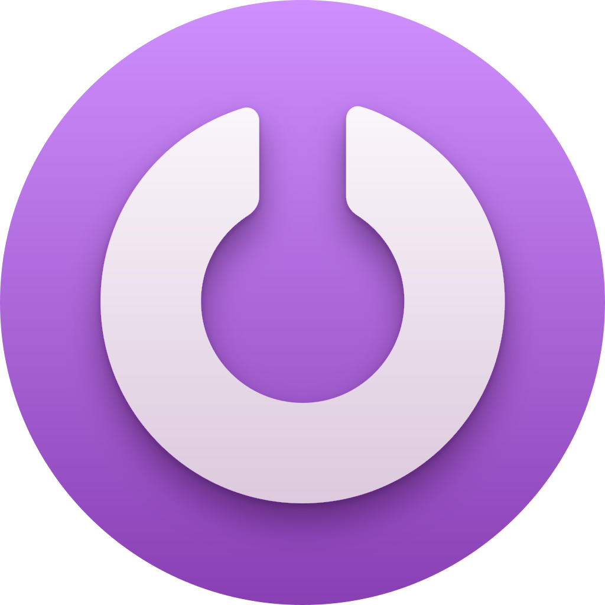

# CopyHeap

<p align="center">
  
</p>

<h3 align="center">Менеджер буфера обмена для macOS и Windows</h3>

<p align="center">
  Легковесный, автономный и быстрый менеджер буфера обмена со сквозным шифрованием AES-256 и синхронизацией через GitHub Gist.
</p>

---

## ⚡ Особенности

- **Нулевые тяжелые зависимости**:
  - **Windows**: единый автономный `.exe` (~1.3 МБ) на C++20/Win32 API без .NET, WebView2 или Electron.
  - **macOS**: нативное Swift / SwiftUI приложение (~1.4 МБ) для строки меню (Menu Bar) с минимальным потреблением ресурсов.
- **Интерфейс в духе платформы**:
  - Windows: стиль Windows 11, скругленные карточки, акцентные индикаторы, поддержка Segoe UI Variable, темная и светлая темы.
  - macOS: меню в строке состояния (Menu Bar), мгновенный отклик, нативная иконка в строке меню и Finder, фильтрация скрытых паролей (1Password, Bitwarden), нативный сайдбар и темная/светлая темы.
- **Хранение истории**: автоматическое сохранение до 200 последних текстовых записей.
- **Закреплённые сниппеты**: неограниченное количество закреплённых шаблонов и фраз, которые никогда не удаляются при ротации.
- **Сквозное шифрование (E2E AES-256-CBC)**: облачная синхронизация шифрует закреплённые сниппеты прямо на вашем ПК/Mac. Ключ шифрования вычисляется из персонального токена GitHub (SHA-256). Ни GitHub, ни посторонние лица не могут прочитать содержимое в Gist.
- **Бесшовная фоновая синхронизация**: автоматическое двустороннее объединение закреплённых сниппетов при старте, после закрепления/редактирования (с 5-секундным дебаунсом) и каждые 15 минут в фоне с предварительной проверкой сети.
- **Кроссплатформенная синхронизация**: бесшовный перенос сниппетов между несколькими компьютерами на Windows и macOS.
- **Безопасность учетных данных**: токен GitHub защищён на системном уровне платформы — в системной связке ключей macOS Keychain на Mac и через Windows DPAPI (`CryptProtectData`) на Windows, исключая хранение в открытом виде.
- **Энергоэффективность и производительность**: на Windows мгновенная реакция по системным событиям буфера обмена ОС без лишнего расхода батареи; на macOS адаптивный интервал опроса; предрассчитанные поля быстрого поиска без лишних блокировок и компактное хранение.
- **Быстрый доступ**:
  - Windows: контекстное меню в системном трее со встроенной прокруткой, быстрым копированием в один клик и безопасной очисткой истории.
  - macOS: выпадающее меню в строке состояния (Menu Bar).
- **Мгновенный поиск**: фильтрация истории без учёта регистра по кириллице и латинице (`Ctrl+F` на Windows / `Cmd+F` на Mac).
- **Автономность и приватность**: работает без прав администратора, данные хранятся локально в профиле пользователя (`%LOCALAPPDATA%\CopyHeap` на Windows, `~/Library/Application Support/CopyHeap` на macOS).

---

## 🚀 Установка и запуск

Скачайте актуальную версию из раздела [Releases](https://github.com/pvrt/copyheap/releases/latest) или с [официального сайта](https://pvrt.github.io/copyheap/):

- **Для macOS**: скачайте `CopyHeap-macOS.zip`, распакуйте `CopyHeap.app` и перетащите в папку «Программы» (Applications).
- **Для Windows**: скачайте `CopyHeap.exe` и запустите его (портативная версия, установка не требуется).

---

## 🔒 Синхронизация (GitHub Gist)

Для синхронизации закреплённых сниппетов между вашими компьютерами (Windows и macOS):
1. Откройте меню приложения и выберите **«Синхронизация...»**.
2. Создайте [GitHub Personal Access Token](https://github.com/settings/tokens/new?scopes=gist&description=CopyHeap) с областью видимости `gist`.
3. Вставьте токен в окно настроек. При первой синхронизации автоматически создастся секретный зашифрованный Gist `copyheap_backup`.
4. На всех остальных ваших устройствах вставьте тот же токен — сниппеты автоматически расшифруются и объединятся.

---

## 🛠️ Сборка из исходников

### macOS (Swift 5.9+, macOS 13.0+)
```bash
cd macos
./bundle.sh
```
Готовое приложение будет создано в `macos/build/CopyHeap.app`.

### Windows (CMake 3.20+, C++20, MSVC / MinGW)
```bash
cmake -B build -G "Ninja" -DCMAKE_BUILD_TYPE=Release
cmake --build build --config Release
ctest --test-dir build
```
Готовый бинарник будет находиться в `build/CopyHeap.exe`.

---

## 📄 Лицензия

Распространяется под лицензией MIT.
